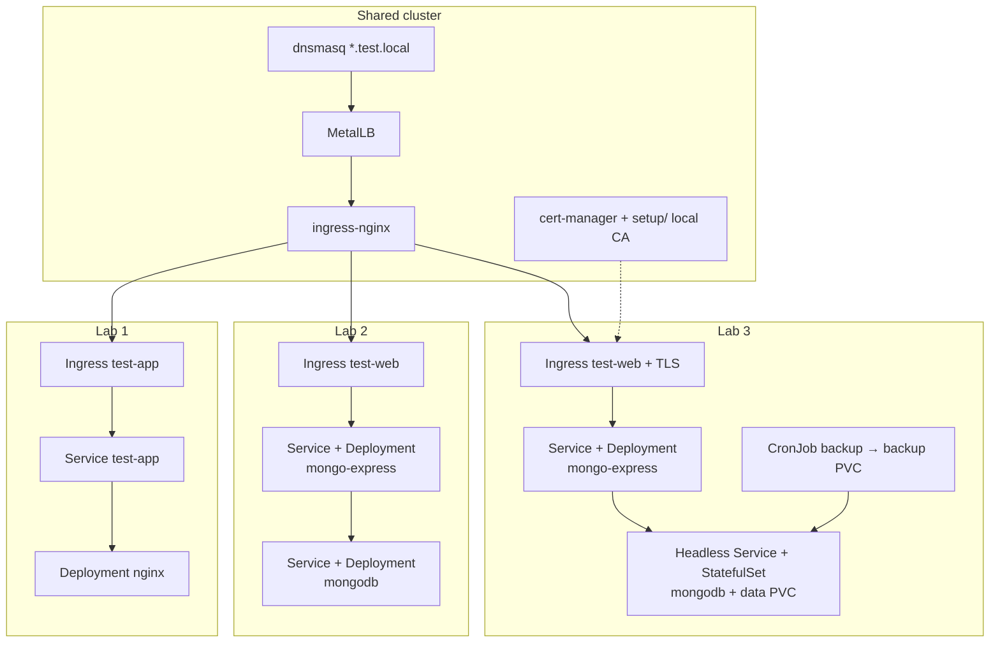

# k8slabs

Local Kubernetes labs on kind (`kind-dev`) with MetalLB + nginx Ingress.

| Lab | Description |
|-----|-------------|
| [lab1](lab1/) | Test nginx Deployment, Service & Ingress |
| [lab2](lab2/) | Web app (mongo-express) connected to MongoDB |
| [lab3](lab3/) | Stateful MongoDB + TLS via cert-manager (`test-web.test.local`) |

## Architecture overview



## Setup (shared)

One-time cluster setup used by labs that need TLS:

| Path | Purpose |
|------|---------|
| [setup/](setup/) | Local CA + `labs-ca-issuer` (cert-manager) |

```bash
# after cert-manager is installed
kubectl apply -f setup/local-ca.yml
```

See [setup/README.md](setup/README.md) to trust the CA on the host.

---

## Kubernetes Dashboard

Web UI to browse cluster resources (pods, deployments, services, logs, etc.).

### Install

Apply the recommended manifests (Dashboard + metrics scraper):

```bash
kubectl apply -f https://raw.githubusercontent.com/kubernetes/dashboard/v2.7.0/aio/deploy/recommended.yaml
```

Create an admin ServiceAccount and bind it to `cluster-admin` (lab / local use only):

```bash
kubectl apply -f - <<'EOF'
apiVersion: v1
kind: ServiceAccount
metadata:
  name: admin-user
  namespace: kubernetes-dashboard
---
apiVersion: rbac.authorization.k8s.io/v1
kind: ClusterRoleBinding
metadata:
  name: admin-user
roleRef:
  apiGroup: rbac.authorization.k8s.io
  kind: ClusterRole
  name: cluster-admin
subjects:
  - kind: ServiceAccount
    name: admin-user
    namespace: kubernetes-dashboard
EOF
```

Check it is running:

```bash
kubectl get pods -n kubernetes-dashboard
```

### Access

The Dashboard Service is ClusterIP-only, so use port-forward:

```bash
kubectl -n kubernetes-dashboard port-forward svc/kubernetes-dashboard 8443:443
```

Open in a browser:

```
https://localhost:8443
```

Accept the self-signed certificate warning.

### Login token

Create a bearer token for `admin-user`:

```bash
kubectl -n kubernetes-dashboard create token admin-user
```

On the login page choose **Token**, paste the output, and sign in.

Optional — token valid for 24 hours:

```bash
kubectl -n kubernetes-dashboard create token admin-user --duration=24h
```

### Cleanup

```bash
kubectl delete -f https://raw.githubusercontent.com/kubernetes/dashboard/v2.7.0/aio/deploy/recommended.yaml
kubectl delete clusterrolebinding admin-user
kubectl delete sa admin-user -n kubernetes-dashboard
```
