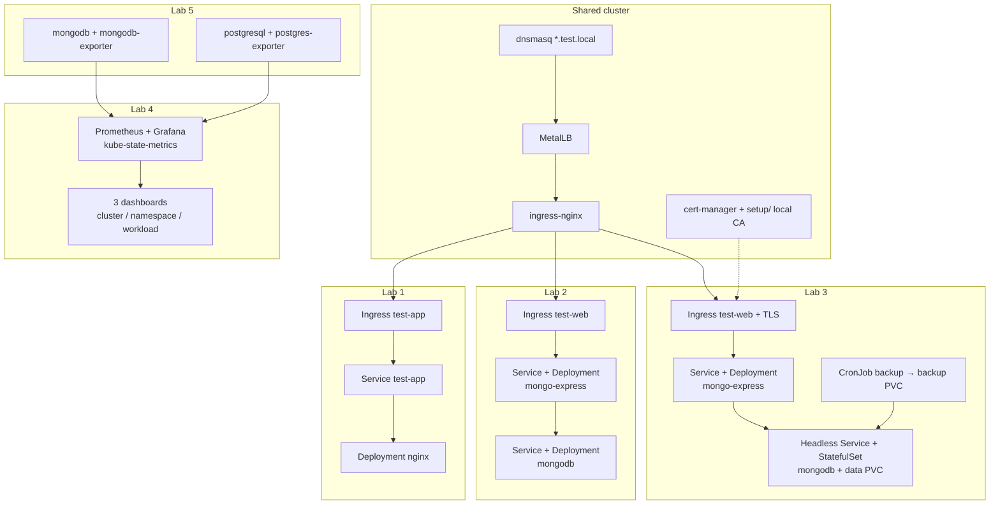

# k8slabs

Local Kubernetes labs on kind (`kind-dev`) with MetalLB + nginx Ingress.

| Lab | Description |
|-----|-------------|
| [lab1](lab1/) | Test nginx Deployment, Service & Ingress |
| [lab2](lab2/) | Web app (mongo-express) connected to MongoDB |
| [lab3](lab3/) | Stateful MongoDB + TLS via cert-manager (`test-web.test.local`) |
| [lab4](lab4/) | Prometheus + Grafana for Kubernetes (3 pod/workload dashboards) |
| [lab5](lab5/) | MongoDB & PostgreSQL exporters + Grafana DB dashboards |

## Architecture overview



## Setup (shared)

One-time / shared cluster pieces used by labs:

| Path | Purpose |
|------|---------|
| [setup/local-ca.yml](setup/local-ca.yml) | Local CA + `labs-ca-issuer` (cert-manager) — lab3, dashboard |
| [setup/dashboard/](setup/dashboard/) | Kubernetes Dashboard Ingress — [README](setup/dashboard/README.md) |

Prometheus + Grafana live in **[lab4](lab4/)** (not under `setup/`).

```bash
# after cert-manager is installed (lab3 TLS / dashboard TLS)
kubectl apply -f setup/local-ca.yml

# Prometheus + Grafana (lab4) — after prometheus-operator bundle is installed
kubectl apply -f lab4/prometheus.yml
kubectl create configmap grafana-dashboards -n monitoring \
  --from-file=lab4/grafana/dashboards/ \
  --dry-run=client -o yaml | kubectl apply -f -
kubectl apply -f lab4/grafana/grafana.yml

# lab5 — MongoDB / PostgreSQL exporters + DB dashboards
# see lab5/README.md

# dashboard UI (after Dashboard + local CA are installed)
kubectl apply -f setup/dashboard/admin-user.yml
kubectl apply -f setup/dashboard/ingress.yml
```

See [setup/README.md](setup/README.md) for CA trust and Dashboard details.

---

## Kubernetes Dashboard

Web UI at `https://dashboard.test.local` — full install and Ingress steps:

→ **[setup/dashboard/README.md](setup/dashboard/README.md)**
