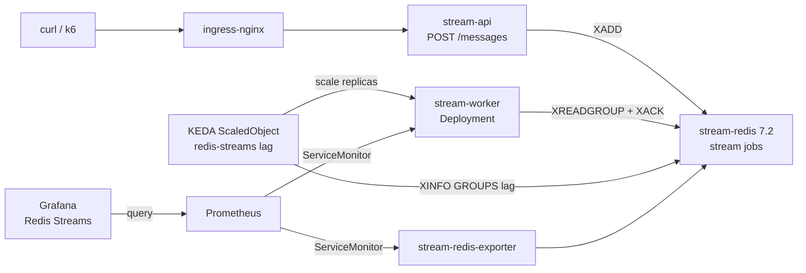

# Lab 10 — Redis Streams + KEDA autoscaled workers

Same pattern as [lab9](../lab9/): HTTP **producer** → Redis stream → **workers** with e2e `/metrics` and Grafana. Difference: **KEDA** scales `stream-worker` from Redis consumer-group **lag** (Redis 7 `XINFO GROUPS`).

Uses its own **Redis 7.2** (`stream-redis`, image `redis:7.2-alpine`). Optional: **Prometheus / Grafana from [lab4](../lab4/)** for the streams board.

**Conflicts with lab9** (same resource names). Clean up lab9 first if it is applied.

## Files

| Path | Purpose |
|------|---------|
| [`redis.yml`](redis.yml) | Redis 7 + redis_exporter + Redis Insight UI |
| [`main.yml`](main.yml) | Config + `stream-api` + `stream-worker` Deployment + **KEDA ScaledObject** + Ingress |
| [`WORKER-E2E-METRICS.md`](WORKER-E2E-METRICS.md) | Worker `/metrics` e2e export — endpoint + code |
| [`stress-job.yml`](stress-job.yml) | k6 CronJob (suspended) — trigger manually; normal → peak → normal |
| [`dashboards/redis-streams.json`](dashboards/redis-streams.json) | Grafana board — Redis stream + worker metrics |

## What this creates

| Resource | Name | Notes |
|----------|------|-------|
| ConfigMap | `stream-lab-config` | `STREAM=jobs`, `GROUP=workers`, `BATCH_SIZE=100`, `PROCESS_SECONDS=3` |
| Deployment/Service/Ingress | `stream-api` | `POST /messages` → `XADD` · host `stream-api.test.local` |
| Deployment | `stream-worker` | starts at 1 replica · consumer name = pod hostname · e2e `/metrics` |
| ScaledObject / HPA | `stream-worker` | KEDA owns replicas · `lagCount=10` · min 1 / max 10 |
| Service / ServiceMonitor | `stream-worker` | Prometheus scrapes worker histogram (enter → ACK) |
| ConfigMap (monitoring) | `grafana-dashboards-redis-streams` | Grafana board **Redis Streams** |
| Deployment/Service | `stream-redis` | Redis **7.2** (`stream-redis.default.svc:6379`) |
| Deployment/Service/ServiceMonitor | `stream-redis-exporter` | Scrapes stream `jobs` for Grafana |
| Deployment/Service/Ingress | `redis-insight` | UI at `redis-insight.test.local` → `stream-redis.default.svc:6379` |

## Architecture



## How it works

1. `POST /messages` with JSON `{"body":"..."}` runs **XADD** on stream `jobs`.
2. Workers ensure consumer group `workers` exists (`XGROUP CREATE … MKSTREAM`).
3. Each worker **XREADGROUP** up to `BATCH_SIZE` (default **100**), sleeps `PROCESS_SECONDS` once for the batch, then **XACK**s all.
4. KEDA polls Redis every **5s**, reads consumer-group **lag** (entries not yet delivered to the group), and sets desired replicas ≈ `ceil(lag / lagCount)` (`lagCount=10`), clamped to **1…10**.
5. On scale-down, remaining workers **XAUTOCLAIM** idle PEL entries; idle consumers with empty PEL are deleted after ~60s.
6. redis_exporter + worker `/metrics` feed Grafana (**Redis Streams**).

Worker e2e `/metrics` (endpoint + code): see [`WORKER-E2E-METRICS.md`](WORKER-E2E-METRICS.md).

### Lab9 vs Lab10

| | Lab 9 | Lab 10 |
|--|-------|--------|
| Redis | 6.2.3 | **7.2** (lag for KEDA) |
| Workers | StatefulSet, fixed **2** replicas | Deployment, **KEDA** 1→10 |
| Consumer name | `worker_1` / `worker_2` (ordinal) | pod **hostname** |
| Scale trigger | manual `kubectl scale` | Redis stream **lag** |

## Prerequisites

- kind cluster (`kind-dev`)
- ingress-nginx + MetalLB + `*.test.local` DNS
- lab4 Prometheus + Grafana (for the streams board only)
- **KEDA** (install once):

```bash
helm repo add kedacore https://kedacore.github.io/charts
helm repo update
helm upgrade --install keda kedacore/keda \
  --namespace keda --create-namespace --wait
kubectl get pods -n keda
```

## Apply

From **repo root** (cleanup lab9 first if needed):

```bash
# optional if lab9 is still around
kubectl delete -f lab9/stress-job.yml --ignore-not-found
kubectl delete -f lab9/main.yml --ignore-not-found
kubectl delete -f lab9/redis.yml --ignore-not-found

# Redis 7 + Redis Insight
kubectl apply -f lab10/redis.yml
kubectl wait --for=condition=Available \
  deploy/stream-redis deploy/stream-redis-exporter deploy/redis-insight --timeout=180s

# Apps + KEDA ScaledObject
kubectl apply -f lab10/main.yml
kubectl wait --for=condition=Available deploy/stream-api deploy/stream-worker --timeout=180s
kubectl get scaledobject stream-worker

# Grafana board (projected volume needs lab4/grafana.yml with redis-streams ConfigMap)
kubectl apply -f lab4/grafana.yml
kubectl create configmap grafana-dashboards-redis-streams -n monitoring \
  --from-file=lab10/dashboards/ \
  --dry-run=client -o yaml | kubectl apply -f -
kubectl -n monitoring rollout restart deployment/grafana
```

Check:

```bash
kubectl get deploy,svc,ingress,scaledobject,hpa -l 'app in (stream-redis,stream-redis-exporter,stream-api,stream-worker,redis-insight)'
kubectl get pods -l app=stream-worker
kubectl logs -l app=stream-worker --tail=20
kubectl exec deploy/stream-redis -- redis-cli XINFO GROUPS jobs

# lag metric path KEDA uses
kubectl exec deploy/stream-redis -- redis-cli XINFO GROUPS jobs
```

## Access

| UI / API | URL |
|----------|-----|
| Producer API | http://stream-api.test.local |
| Redis Insight | http://redis-insight.test.local |
| Grafana board | http://grafana.test.local → **Redis Streams** (`admin` / `admin`) |

### Redis Insight — connect to lab Redis

1. Open http://redis-insight.test.local
2. **Add Redis database**
3. Host: `stream-redis.default.svc` · Port: `6379` · no password
4. Open stream key `jobs` → view entries, consumer group `workers`, pending / lag

(Use the in-cluster hostname — Redis Insight runs inside the cluster.)

## Push messages

Single message:

```bash
curl -s -X POST http://stream-api.test.local/messages \
  -H 'Content-Type: application/json' \
  -d '{"body":"hello from lab10"}'
```

## Stress test (k6 CronJob — drives KEDA)

[k6](https://k6.io) drives `POST /messages` with **ramping-arrival-rate** stages (~4 min total). Peak load grows consumer-group lag → KEDA adds worker pods.

CronJob is **`suspend: true`** by default (no automatic runs). Trigger whenever you want:

| Phase | Duration | Rate |
|-------|----------|------|
| Ramp to normal | 20s | → 5 req/s |
| Normal | 60s | 5 req/s |
| Spike to peak | 10s | → 400 req/s |
| Hold peak | 30s | 400 req/s |
| Cool down | 20s | → 5 req/s |
| Normal again | 60s | 5 req/s |
| Ramp to low | 10s | → 1 req/s |
| Low load | 30s | 1 req/s |
| Stop | 10s | → 0 |

Install CronJob once:

```bash
kubectl apply -f lab10/stress-job.yml
```

**Trigger manually** (creates a one-off Job from the CronJob template):

```bash
kubectl create job stream-api-k6-manual-$(date +%s) --from=cronjob/stream-api-k6
```

Watch scale-out / scale-in:

```bash
watch -n 2 'kubectl get scaledobject stream-worker; kubectl get hpa; kubectl get pods -l app=stream-worker; kubectl exec deploy/stream-redis -- redis-cli XINFO GROUPS jobs'
```

Also:

```bash
kubectl get jobs -l role=stress
kubectl logs -l job=k6 -f --tail=50
kubectl logs -l app=stream-worker --tail=30
```

Run again anytime with another `kubectl create job ... --from=cronjob/stream-api-k6` (use a unique job name each time).

Optional — enable the schedule (every 6h as defined in the YAML):

```bash
kubectl patch cronjob stream-api-k6 -p '{"spec":{"suspend":false}}'
# suspend again:
kubectl patch cronjob stream-api-k6 -p '{"spec":{"suspend":true}}'
```

Tune rates: edit `NORMAL_RPS` / `PEAK_RPS` / `LOW_RPS` in `stress-job.yml`, then `kubectl apply -f lab10/stress-job.yml`.

Tune KEDA: edit `lagCount` / `maxReplicaCount` / `cooldownPeriod` on the ScaledObject in `main.yml`.

## Grafana panels (metrics covered)

| Panel | Metric |
|-------|--------|
| Stream length | `redis_stream_length` |
| Consumer groups | `redis_stream_groups` |
| Delivery lag (ID time) | `redis_stream_last_generated_id` − `redis_stream_group_last_delivered_id` |
| Group lag (Redis 7) | `redis_stream_group_lag` (when exporter exposes it) |
| Pending | `redis_stream_group_messages_pending` |
| Consumers | `redis_stream_group_consumers` |
| Entries ACKed | `stream_messages_acked_total` (worker) |
| **Avg / p50 / p95 e2e latency (per group)** | `stream_message_e2e_latency_seconds` (worker) |
| ACK rate | `stream_messages_acked_total` |

## Expected observations

| Action | What you see |
|--------|----------------|
| Idle / light load | 1 worker pod; lag near 0; ScaledObject Ready |
| During k6 peak | lag ↑; HPA/ScaledObject raises replicas toward **10** |
| After peak | lag drains; replicas fall back toward **1** after the HPA scale-down window (~5 min default — `cooldownPeriod` only applies to scale-to-zero) |
| Grafana during peak | delivery lag / pending ↑ then drain as workers catch up |
| Redis Insight | more consumers appear while scaled out; idle ones cleaned after ~60s |

## Cleanup

```bash
kubectl delete -f lab10/stress-job.yml --ignore-not-found   # CronJob + k6 ConfigMap
kubectl delete jobs -l role=stress --ignore-not-found
kubectl delete -f lab10/main.yml --ignore-not-found         # includes ScaledObject
kubectl delete -f lab10/redis.yml --ignore-not-found
kubectl delete configmap grafana-dashboards-redis-streams -n monitoring --ignore-not-found
kubectl -n monitoring rollout restart deployment/grafana
```

Does **not** remove Prometheus / Grafana ([lab4](../lab4/)) or the KEDA operator (`helm uninstall keda -n keda`).
