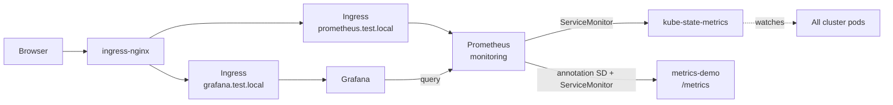

# Lab 4 — Prometheus + Grafana for Kubernetes

Configure **Prometheus Operator**, **Prometheus**, and **Grafana** on your kind cluster to scrape metrics about pods and workloads, with three provisioned dashboards.

Database exporters (MongoDB / PostgreSQL): see **[lab5](../lab5/)**.

## Files

| Path | Purpose |
|------|---------|
| [`prometheus.yml`](prometheus.yml) | Namespace, RBAC, Prometheus CR, kube-state-metrics, ServiceMonitors, Ingress, metrics-demo |
| [`grafana.yml`](grafana.yml) | Grafana + Prometheus datasource + Ingress |
| [`dashboards/`](dashboards/) | **Cluster Pods**, **Pods by Namespace**, **Workload Pods** |

## What this creates

| Resource       | Name                 | Notes                                                |
|----------------|----------------------|------------------------------------------------------|
| Namespace      | `monitoring`         | Prometheus + kube-state-metrics + Grafana            |
| Prometheus     | `prometheus`         | Scrapes ServiceMonitors / PodMonitors + annotated pods |
| Service/Ingress| `prometheus`         | UI at `http://prometheus.test.local`                 |
| Deployment     | `kube-state-metrics` | Metrics **about every pod** (`kube_pod_*`)           |
| ServiceMonitor | `kube-state-metrics` | Tells Prometheus to scrape kube-state-metrics        |
| Deployment     | `metrics-demo`       | Tiny app with `/metrics` (annotation scrape demo)    |
| ServiceMonitor | `metrics-demo`       | Scrapes the demo app                                 |
| Deployment     | `grafana`            | Dashboards over Prometheus                           |
| Service/Ingress| `grafana`            | UI at `http://grafana.test.local` (admin / admin)    |

## Architecture



## How Prometheus gets data from all pods

1. **kube-state-metrics** watches the Kubernetes API and exports metrics for every pod (`kube_pod_info`, `kube_pod_status_phase`, `kube_pod_container_status_restarts_total`, …).
2. A **ServiceMonitor** points Prometheus at kube-state-metrics.
3. **Annotation scrape** (extra job in `additional-scrape-configs`): any pod with `prometheus.io/scrape: "true"` is scraped (see `metrics-demo`). Optional annotations: `prometheus.io/port`, `prometheus.io/path`.

## Prerequisites

- kind cluster (`kind-dev`)
- ingress-nginx controller
- MetalLB (LoadBalancer EXTERNAL-IP)
- Wildcard DNS for `*.test.local` (dnsmasq)

Plus the **Prometheus Operator** CRDs + controller (once per cluster):

```bash
kubectl apply --server-side -f \
  https://raw.githubusercontent.com/prometheus-operator/prometheus-operator/v0.78.2/bundle.yaml

kubectl wait --for=condition=Available deployment/prometheus-operator \
  -n default --timeout=120s
```

> The upstream `bundle.yaml` installs the operator into the `default` namespace. That is fine for local labs.

## Apply

From **lab4/** (or use paths from the repo root):

```bash
# 1) Prometheus Operator stack
kubectl apply -f prometheus.yml

# 2) Grafana — load the 3 dashboard JSON files, then deploy
kubectl create configmap grafana-dashboards -n monitoring \
  --from-file=dashboards/ \
  --dry-run=client -o yaml | kubectl apply -f -
kubectl apply -f grafana.yml
```

From **repo root**:

```bash
kubectl apply -f lab4/prometheus.yml
kubectl create configmap grafana-dashboards -n monitoring \
  --from-file=lab4/dashboards/ \
  --dry-run=client -o yaml | kubectl apply -f -
kubectl apply -f lab4/grafana.yml
```

Wait until ready:

```bash
kubectl -n monitoring wait --for=condition=Available prometheus/prometheus --timeout=180s
kubectl -n monitoring wait --for=condition=Available deployment/grafana --timeout=120s
kubectl get pods -n monitoring
kubectl get pods -l app=metrics-demo
```

## Access

| UI | URL | Login |
|----|-----|-------|
| Prometheus | http://prometheus.test.local | — |
| Grafana | http://grafana.test.local | `admin` / `admin` |

### The 3 dashboards

| Dashboard | What it shows |
|-----------|----------------|
| **Cluster Pods** | Overview of `kube_pod_*` across the cluster |
| **Pods by Namespace — Resources** | Filter by namespace/pod; CPU, memory, requests/limits, network, FS, restarts |
| **Workload Pods** | Pick Deployment / StatefulSet / DaemonSet; pods with CPU/memory/replicas |

Add more boards by dropping `*.json` into `dashboards/`, re-create the ConfigMap, then:

```bash
kubectl -n monitoring rollout restart deployment/grafana
```

### Useful queries

In Prometheus → **Graph**:

```promql
kube_pod_info
kube_pod_status_phase
kube_pod_container_status_restarts_total
version   # metrics-demo custom metric
```

### Targets

Open Prometheus → **Status → Targets** and confirm:

- `serviceMonitor/monitoring/kube-state-metrics` — UP
- `serviceMonitor/default/metrics-demo` — UP
- `kubernetes-pods` — UP for `metrics-demo` (annotation scrape)
- `kubelet-cadvisor` — UP (real CPU / memory / network / FS usage)

## Enable scraping on your own pods

```yaml
metadata:
  annotations:
    prometheus.io/scrape: "true"
    prometheus.io/port: "8080"
    prometheus.io/path: "/metrics"
```

The container must serve Prometheus text format on that path/port.

## Cleanup

```bash
kubectl delete configmap grafana-dashboards -n monitoring --ignore-not-found
kubectl delete -f grafana.yml
kubectl delete -f prometheus.yml
```

Optional — remove the Prometheus Operator:

```bash
kubectl delete -f \
  https://raw.githubusercontent.com/prometheus-operator/prometheus-operator/v0.78.2/bundle.yaml
```
