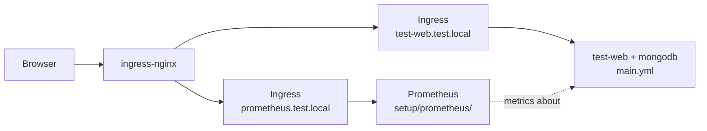

# Lab 4 — Web App + MongoDB + Prometheus Operator

Same app stack as [lab2](../lab2/) (mongo-express + MongoDB), plus the shared Prometheus stack under [`setup/prometheus/`](../setup/prometheus/).

## Files

| File | Purpose |
|------|---------|
| [`main.yml`](main.yml) | Same as lab2 — Secret, MongoDB, test-web, Ingress |
| [`../setup/prometheus/`](../setup/prometheus/) | Shared setup — Prometheus Operator stack (see its README) |

## What this creates

### From `main.yml` (lab2)

| Resource   | Name             | Notes                                              |
|------------|------------------|----------------------------------------------------|
| Secret     | `mongodb-secret` | MongoDB username / password / database             |
| Deployment | `mongodb`        | 1 replica, `mongo:7.0`                             |
| Service    | `mongodb`        | ClusterIP, port 27017                              |
| Deployment | `test-web`       | 2 replicas, `mongo-express` → connects to MongoDB  |
| Service    | `test-web`       | ClusterIP, port 80 → 8081                          |
| Ingress    | `test-web`       | host `test-web.test.local`, class `nginx`          |

### From `setup/prometheus/`

Prometheus, kube-state-metrics, ServiceMonitors, and Ingress — full list in [`setup/prometheus/README.md`](../setup/prometheus/README.md).

## Architecture



## Prerequisites

Same as lab1 / lab2:

- kind cluster (`kind-dev`)
- ingress-nginx controller
- MetalLB (LoadBalancer EXTERNAL-IP)
- Wildcard DNS for `*.test.local` (dnsmasq)

Plus Prometheus Operator — see [`setup/prometheus/README.md`](../setup/prometheus/README.md).

## Apply

```bash
# 1) App stack (same as lab2)
kubectl apply -f main.yml

# 2) Prometheus stack (shared setup)
kubectl apply -f ../setup/prometheus/prometheus.yml
```

Check app:

```bash
kubectl get deploy,svc,ingress -l 'app in (mongodb,test-web)'
kubectl get pods -l 'app in (mongodb,test-web)'
```

Prometheus status, queries, and targets: [`setup/prometheus/README.md`](../setup/prometheus/README.md).

## Access

App:

```
http://test-web.test.local
```

Prometheus UI:

```
http://prometheus.test.local
```

## Cleanup

```bash
kubectl delete -f ../setup/prometheus/prometheus.yml
kubectl delete -f main.yml
```

Optional — remove the operator: see [`setup/prometheus/README.md`](../setup/prometheus/README.md).
