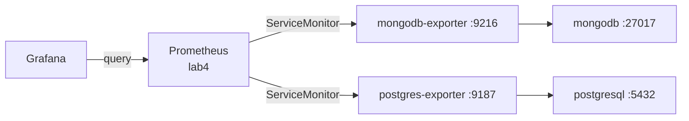

# Lab 5 — MongoDB & PostgreSQL exporters + Grafana dashboards

Export **database-specific** metrics into the Prometheus / Grafana stack from **[lab4](../lab4/)**.

| DB | Exporter | Dashboard |
|----|----------|-----------|
| MongoDB | [gurjarchetan/mongodb-exporter](https://github.com/gurjarchetan/mongodb-exporter) | [25227 — Prod Overview](https://grafana.com/grafana/dashboards/25227-mongodb-prod-overview/) |
| PostgreSQL | [postgres_exporter](https://github.com/prometheus-community/postgres_exporter) | [9628 — PostgreSQL Database](https://grafana.com/grafana/dashboards/9628-postgresql-database/) |

## Files

| Path | Purpose |
|------|---------|
| [`mongodb/mongodb.yml`](mongodb/mongodb.yml) | MongoDB Secret + Deployment + Service |
| [`mongodb/mongodb-exporter.yml`](mongodb/mongodb-exporter.yml) | Exporter + ServiceMonitor |
| [`mongodb/dashboards/`](mongodb/dashboards/) | Grafana board 25227 |
| [`postgresql/postgres-exporter.yml`](postgresql/postgres-exporter.yml) | PostgreSQL + exporter + ServiceMonitor |
| [`postgresql/dashboards/`](postgresql/dashboards/) | Grafana board 9628 (adapted for Grafana 11) |

## Architecture



## Prerequisites

- kind cluster (`kind-dev`)
- ingress-nginx + MetalLB + `*.test.local` DNS
- Prometheus Operator + lab4 stack — [lab4/README.md](../lab4/README.md)

```bash
# if not already applied (lab4)
kubectl apply -f ../lab4/prometheus.yml
kubectl create configmap grafana-dashboards -n monitoring \
  --from-file=../lab4/grafana/dashboards/ \
  --dry-run=client -o yaml | kubectl apply -f -
kubectl apply -f ../lab4/grafana/grafana.yml
```

## Apply

From **lab5/** (or use paths from repo root):

```bash
# MongoDB + exporter
kubectl apply -f mongodb/mongodb.yml
kubectl apply -f mongodb/mongodb-exporter.yml

# PostgreSQL + exporter (includes the DB)
kubectl apply -f postgresql/postgres-exporter.yml

# Grafana boards (separate ConfigMaps — annotation size limit)
kubectl create configmap grafana-dashboards-mongodb -n monitoring \
  --from-file=mongodb/dashboards/ \
  --dry-run=client -o yaml | kubectl apply -f -
kubectl create configmap grafana-dashboards-postgresql -n monitoring \
  --from-file=postgresql/dashboards/ \
  --dry-run=client -o yaml | kubectl apply -f -
kubectl -n monitoring rollout restart deployment/grafana
```

From **repo root**:

```bash
kubectl apply -f lab5/mongodb/mongodb.yml
kubectl apply -f lab5/mongodb/mongodb-exporter.yml
kubectl apply -f lab5/postgresql/postgres-exporter.yml

kubectl create configmap grafana-dashboards-mongodb -n monitoring \
  --from-file=lab5/mongodb/dashboards/ \
  --dry-run=client -o yaml | kubectl apply -f -
kubectl create configmap grafana-dashboards-postgresql -n monitoring \
  --from-file=lab5/postgresql/dashboards/ \
  --dry-run=client -o yaml | kubectl apply -f -
kubectl -n monitoring rollout restart deployment/grafana
```

Check:

```bash
kubectl get pods,svc,servicemonitor -l 'app in (mongodb,mongodb-exporter,postgresql,postgres-exporter)'
kubectl wait --for=condition=Available deployment/mongodb --timeout=120s
kubectl wait --for=condition=Available deployment/mongodb-exporter --timeout=120s
kubectl wait --for=condition=Available deployment/postgresql --timeout=120s
kubectl wait --for=condition=Available deployment/postgres-exporter --timeout=120s
```

Prometheus → **Status → Targets**:

- `serviceMonitor/default/mongodb-exporter` — UP
- `serviceMonitor/default/postgres-exporter` — UP

## Access

| UI | URL |
|----|-----|
| Grafana | http://grafana.test.local (`admin` / `admin`) |
| Prometheus | http://prometheus.test.local |

Dashboards: **MongoDB — Prod Overview**, **PostgreSQL Database**.

Default credentials:

| DB | User | Password | Database |
|----|------|----------|----------|
| MongoDB | `admin` | `changeme` | `testdb` |
| PostgreSQL | `app` | `changeme` | `appdb` |

## Cleanup

```bash
kubectl delete -f postgresql/postgres-exporter.yml --ignore-not-found
kubectl delete -f mongodb/mongodb-exporter.yml --ignore-not-found
kubectl delete -f mongodb/mongodb.yml --ignore-not-found
kubectl delete configmap grafana-dashboards-mongodb grafana-dashboards-postgresql \
  -n monitoring --ignore-not-found
kubectl -n monitoring rollout restart deployment/grafana
```

Does **not** remove the Prometheus / Grafana stack ([lab4](../lab4/)).
