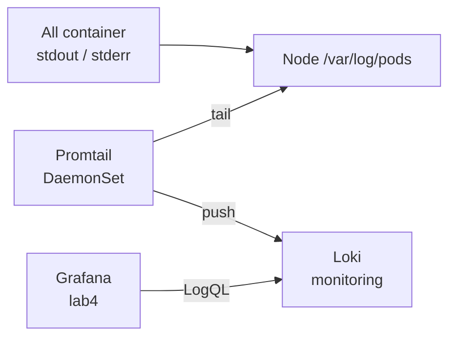

# Lab 6 — Container logs → Grafana (Loki + Promtail)

Ship **all container logs** from every node into Grafana using [Loki](https://grafana.com/oss/loki/) + [Promtail](https://grafana.com/docs/loki/latest/send-data/promtail/).

Depends on **[lab4](../lab4/)** (Grafana already running).

## Files

| Path | Purpose |
|------|---------|
| [`loki.yml`](loki.yml) | Loki Deployment + Service (log store) |
| [`promtail.yml`](promtail.yml) | Promtail DaemonSet — tails `/var/log/pods` on each node |
| [`grafana-datasources.yml`](grafana-datasources.yml) | Adds **Loki** datasource next to Prometheus |
| [`dashboards/kubernetes-logs.json`](dashboards/kubernetes-logs.json) | Simple logs board — namespace / pod / container |
| [`dashboards/loki-dashboard-13186.json`](dashboards/loki-dashboard-13186.json) | [Loki Dashboard (13186)](https://grafana.com/grafana/dashboards/13186-loki-dashboard/) — timeline + logs (adapted for Promtail labels) |

## Architecture



## Prerequisites

- kind cluster (`kind-dev`)
- Lab4 Prometheus + Grafana applied — [lab4/README.md](../lab4/README.md)

## Apply

From **repo root**:

```bash
# 1) Log store
kubectl apply -f lab6/loki.yml
kubectl -n monitoring wait --for=condition=Available deployment/loki --timeout=120s

# 2) Ship logs from every node
kubectl apply -f lab6/promtail.yml
kubectl -n monitoring rollout status daemonset/promtail --timeout=120s

# 3) Ensure Grafana has Loki datasource (also baked into lab4/grafana.yml)
kubectl apply -f lab6/grafana-datasources.yml

# 4) Logs dashboard
kubectl create configmap grafana-dashboards-logs -n monitoring \
  --from-file=lab6/dashboards/ \
  --dry-run=client -o yaml | kubectl apply -f -

# 5) Refresh Grafana Deployment (optional mounts) + restart so Loki appears in Explore
kubectl apply -f lab4/grafana.yml
kubectl apply -f lab6/grafana-datasources.yml
kubectl -n monitoring rollout restart deployment/grafana
kubectl -n monitoring rollout status deployment/grafana --timeout=120s
```

> Apply **`lab6/grafana-datasources.yml` after** `lab4/grafana.yml` (or use the updated lab4 file that already includes Loki). Otherwise Explore only shows Prometheus.

From **lab6/**:

```bash
kubectl apply -f loki.yml
kubectl apply -f promtail.yml
kubectl apply -f ../lab4/grafana.yml
kubectl apply -f grafana-datasources.yml
kubectl create configmap grafana-dashboards-logs -n monitoring \
  --from-file=dashboards/ \
  --dry-run=client -o yaml | kubectl apply -f -
kubectl -n monitoring rollout restart deployment/grafana
```

Check:

```bash
kubectl get pods -n monitoring -l 'app in (loki,promtail,grafana)'
kubectl logs -n monitoring -l app=promtail --tail=20
```

## Access

Grafana (`admin` / `admin`):

```
http://grafana.test.local
```

1. Open **Loki Dashboard** (13186) or **Kubernetes Logs** — pick namespace / pod / container, optional search.
2. Or **Explore** → datasource **Loki**, e.g.:

```logql
{namespace="monitoring"}
{namespace="default", pod=~".+"}
{container="grafana"} |= "error"
```

> Loki rejects `=~".*"` (matches empty). Use `=~".+"` or a concrete label like `namespace="monitoring"`.

## How it works

1. Kubernetes writes each container’s stdout/stderr under `/var/log/pods/<pod-uid>/<container>/*.log` on the node.
2. **Promtail** (DaemonSet) discovers pods via the API and tails those files.
3. Promtail pushes streams to **Loki** with labels `namespace`, `pod`, `container`.
4. **Grafana** queries Loki with LogQL (same UI as Prometheus metrics).

## Cleanup

```bash
kubectl delete configmap grafana-dashboards-logs -n monitoring --ignore-not-found
kubectl delete -f lab6/promtail.yml --ignore-not-found
kubectl delete -f lab6/loki.yml --ignore-not-found

# Restore Prometheus-only datasources from lab4, then restart Grafana
kubectl apply -f lab4/grafana.yml
kubectl -n monitoring rollout restart deployment/grafana
```

Does **not** remove lab4 Prometheus / Grafana.
