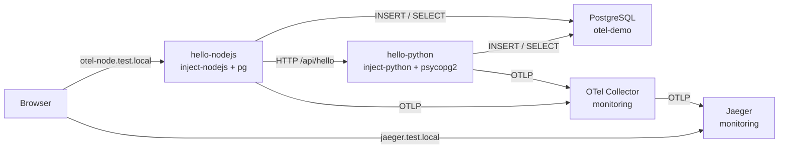

# Lab 7 — OpenTelemetry Operator → Jaeger (auto-instrumentation)

Install the **[OpenTelemetry Operator](https://opentelemetry.io/docs/platforms/kubernetes/operator/)**, ship traces to **[Jaeger](https://www.jaegertracing.io/)**, and demo **auto-instrumentation** on Python + Node.js test services — view spans in the Jaeger UI.

Depends on **cert-manager** (Operator webhooks) and the shared Ingress / `*.test.local` setup. Lab4 Grafana is **not** required for this lab (traces are viewed in Jaeger).

## Files

| Path | Purpose |
|------|---------|
| [`jaeger.yml`](jaeger.yml) | Jaeger all-in-one + Service + Ingress (`jaeger.test.local`) |
| [`otel-collector.yml`](otel-collector.yml) | `OpenTelemetryCollector` CR — receives OTLP, exports to Jaeger |
| [`instrumentation.yml`](instrumentation.yml) | `Instrumentation` CR — agent inject + OTLP endpoint |
| [`test-services.yml`](test-services.yml) | Postgres + auto-instrumented Python / Node demos + Ingress |

## Architecture



## Prerequisites

- kind cluster (`kind-dev`)
- ingress-nginx + MetalLB + `*.test.local` DNS
- **cert-manager** (Operator admission webhooks) — already used by lab3 / `setup/local-ca.yml`

## 1) Install OpenTelemetry Operator (once per cluster)

```bash
# cert-manager must be Ready first
kubectl wait --for=condition=Available deployment/cert-manager -n cert-manager --timeout=120s

kubectl apply -f https://github.com/open-telemetry/opentelemetry-operator/releases/download/v0.161.0/opentelemetry-operator.yaml

kubectl wait --for=condition=Available deployment/opentelemetry-operator-controller-manager \
  -n opentelemetry-operator-system --timeout=180s
```

## 2) Apply

From **repo root**:

```bash
# Trace store + UI
kubectl apply -f lab7/jaeger.yml
kubectl -n monitoring wait --for=condition=Available deployment/jaeger --timeout=120s

# Collector (Operator creates Deployment + Service otel-collector)
kubectl apply -f lab7/otel-collector.yml
kubectl -n monitoring wait --for=condition=Available deployment/otel-collector --timeout=120s

# Auto-instrumentation config
kubectl apply -f lab7/instrumentation.yml

# Demo apps + Postgres (opt-in via annotations)
kubectl apply -f lab7/test-services.yml
kubectl -n otel-demo wait --for=condition=Available deployment/postgres --timeout=120s
kubectl -n otel-demo wait --for=condition=Available deployment/hello-python --timeout=240s
kubectl -n otel-demo wait --for=condition=Available deployment/hello-nodejs --timeout=240s
```

Check:

```bash
kubectl get pods -n monitoring -l app=jaeger
kubectl get pods -n monitoring -l app.kubernetes.io/name=otel-collector
kubectl get pods -n otel-demo
kubectl get instrumentation -n monitoring
# init containers should appear (instrumentation inject)
kubectl get pod -n otel-demo -l app=hello-python -o jsonpath='{.items[0].spec.initContainers[*].name}{"\n"}'
kubectl get pod -n otel-demo -l app=hello-nodejs -o jsonpath='{.items[0].spec.initContainers[*].name}{"\n"}'
```

## Access

### Generate traces

```bash
# Distributed trace: Node (pg INSERT) → Python (pg INSERT/SELECT) → Postgres
curl -s http://otel-node.test.local/ | jq .

# Python DB endpoints
curl -s http://otel-python.test.local/api/hello | jq .
curl -s http://otel-python.test.local/api/notes | jq .
curl -s http://otel-python.test.local/api/slow | jq .

# Node list notes
curl -s http://otel-node.test.local/api/notes | jq .

# A few more for Search
for i in $(seq 1 10); do curl -s -o /dev/null http://otel-node.test.local/; done
```

### Jaeger UI

```
http://jaeger.test.local
```

1. **Service** → `hello-nodejs` or `hello-python`
2. **Find Traces** — open a `hello-nodejs` `GET /` span
3. You should see **HTTP** child spans into Python **and** **PostgreSQL** spans (`INSERT` / `SELECT`) from both services
4. Or open **System Architecture** for the service graph

## How it works

1. **OpenTelemetry Operator** watches pods for language annotations and injects an init container + env (`OTEL_*`).
2. **Instrumentation** CR points agents at the in-cluster Collector (`otel-collector:4318` OTLP/HTTP).
3. Apps emit spans with **no code changes** — Flask / Express **and** `psycopg2` / `pg` DB calls are auto-instrumented.
4. **Collector** batches and forwards traces to **Jaeger** over OTLP gRPC.
5. **Jaeger UI** shows search, trace waterfall (HTTP + SQL), and service graph.

Opt-in annotations used here:

| Language | Annotation |
|----------|------------|
| Python | `instrumentation.opentelemetry.io/inject-python: "monitoring/demo"` |
| Node.js | `instrumentation.opentelemetry.io/inject-nodejs: "monitoring/demo"` |

Also supported by the Operator: `inject-java`, `inject-dotnet`, `inject-go` (Go needs a feature gate).

## Delete / cleanup

```bash
kubectl delete -f lab7/test-services.yml --ignore-not-found
kubectl delete -f lab7/instrumentation.yml --ignore-not-found
kubectl delete -f lab7/otel-collector.yml --ignore-not-found
kubectl delete -f lab7/jaeger.yml --ignore-not-found
```

Does **not** remove the OpenTelemetry Operator. To remove it as well:

```bash
kubectl delete -f https://github.com/open-telemetry/opentelemetry-operator/releases/download/v0.161.0/opentelemetry-operator.yaml
```

### Migrating from older Tempo + Grafana traces setup

If you previously applied Tempo / Tempo Grafana datasources / the traces dashboard:

```bash
kubectl delete -f lab7/tempo.yml --ignore-not-found
kubectl delete configmap grafana-dashboards-traces -n monitoring --ignore-not-found
# Restore Prometheus (+ Loki) datasources without Tempo
kubectl apply -f lab4/grafana.yml
kubectl -n monitoring rollout restart deployment/grafana
```
