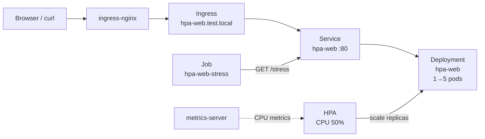

# Lab 8 — Horizontal Pod Autoscaler (HPA)

Deploy a small CPU-burning web app, attach an **HPA** (scale on CPU), then drive load with a **Job** and watch pods scale from 1 → up to 5.

## Files

| File | Purpose |
|------|---------|
| [`main.yml`](main.yml) | ConfigMap (Python app) + Deployment + Service + Ingress + HPA |
| [`stress-job.yml`](stress-job.yml) | Job — parallel curl workers hit `/stress` for ~3 minutes |

## What this creates

| Resource | Name | Notes |
|----------|------|-------|
| ConfigMap | `hpa-web` | Python HTTP server (`/` health, `/stress` CPU burn) |
| Deployment | `hpa-web` | starts at 1 replica, `python:3.12-alpine` |
| Service | `hpa-web` | ClusterIP, port 80 → 8080 |
| Ingress | `hpa-web` | host `hpa-web.test.local` |
| HPA | `hpa-web` | CPU target **50%**, min 1 / max 5 |
| Job | `hpa-web-stress` | 4 parallel pods × concurrent curls → `/stress` |

## Architecture



## How it works

1. Each `/stress` request runs many SHA-256 hashes on the pod CPU.
2. **metrics-server** reports pod CPU to the API.
3. HPA compares average CPU to the **100m** request (target 50% ≈ 50m per pod).
4. Under the stress Job, utilization rises → HPA adds replicas (up to 5).
5. After the Job finishes and load drops, HPA scales down (after the scale-down window).

## Prerequisites

Same as lab1:

- kind cluster (`kind-dev`)
- ingress-nginx + MetalLB + `*.test.local` DNS

Plus **metrics-server** (required for resource-based HPA):

```bash
kubectl apply -f https://github.com/kubernetes-sigs/metrics-server/releases/latest/download/components.yaml

# kind: allow metrics-server to talk to kubelets without a proper TLS SAN
kubectl -n kube-system patch deployment metrics-server --type='json' -p='[
  {"op":"add","path":"/spec/template/spec/containers/0/args/-","value":"--kubelet-insecure-tls"}
]'

kubectl -n kube-system rollout status deploy/metrics-server --timeout=120s
kubectl top nodes
kubectl top pods
```

`kubectl top` should work before you expect HPA to scale.

## Apply

From **repo root**:

```bash
kubectl apply -f lab8/main.yml
kubectl wait --for=condition=Available deploy/hpa-web --timeout=120s
```

Check:

```bash
kubectl get deploy,svc,ingress,hpa hpa-web
kubectl get pods -l app=hpa-web
kubectl describe hpa hpa-web
```

## Access the app

```
http://hpa-web.test.local
http://hpa-web.test.local/stress
```

```bash
curl http://hpa-web.test.local/
curl http://hpa-web.test.local/stress
```

`X-Pod` response header / body shows which replica handled the request.

## Stress test (Job)

Start load (4 parallel worker pods for ~180s):

```bash
kubectl apply -f lab8/stress-job.yml
```

Watch scale-up (another terminal):

```bash
# HPA target / current / replicas
watch -n 2 'kubectl get hpa hpa-web; kubectl get pods -l app=hpa-web; kubectl top pods -l app=hpa-web'
```

Or one-shot:

```bash
kubectl get hpa hpa-web -w
```

You should see `REPLICAS` climb toward 5 while the Job runs, and CPU on `hpa-web-*` pods above the target.

Job status / logs:

```bash
kubectl get job hpa-web-stress
kubectl logs -l job-name=hpa-web-stress --tail=20
```

### Re-run the stress Job

Jobs are immutable once created. Delete then apply again:

```bash
kubectl delete -f lab8/stress-job.yml
kubectl apply -f lab8/stress-job.yml
```

## Expected observations

| Phase | What you see |
|-------|----------------|
| Idle | 1 pod, HPA `TARGETS` near `0%/50%` or `<unknown>` briefly until metrics arrive |
| Under Job | CPU rises, `REPLICAS` increases (2…5) |
| After Job | After ~1 minute scale-down window, replicas step back down toward 1 |

If HPA stays at `<unknown>` / never scales:

1. Confirm metrics-server is Ready and patched with `--kubelet-insecure-tls`.
2. `kubectl top pods -l app=hpa-web` must show CPU.
3. Wait ~30–60s after apply for the first metric samples.

## Cleanup

```bash
kubectl delete -f lab8/stress-job.yml --ignore-not-found
kubectl delete -f lab8/main.yml
```

Optional — remove metrics-server if you installed it only for this lab:

```bash
kubectl delete -f https://github.com/kubernetes-sigs/metrics-server/releases/latest/download/components.yaml
```
