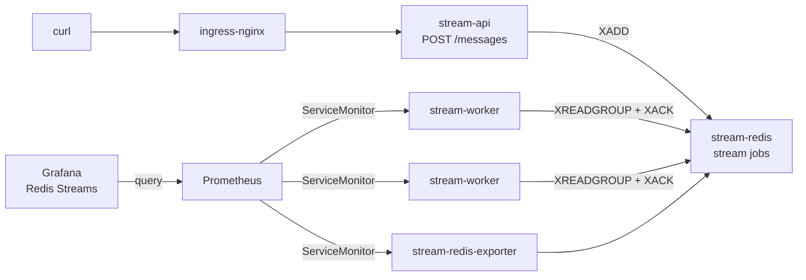

# Lab 9 — Redis Streams (producer + worker + Grafana dashboard)

HTTP **producer** pushes messages onto a Redis stream; **workers** consume via a consumer group and simulate processing with `sleep`. Observe everything redis_exporter exposes for the stream in Grafana (**Redis Streams**).

Includes its own **Redis** (`stream-redis`). Optional: **Prometheus / Grafana from [lab4](../lab4/)** for the streams board.

## Files

| Path | Purpose |
|------|---------|
| [`redis.yml`](redis.yml) | Redis + redis_exporter + Redis Insight UI |
| [`main.yml`](main.yml) | Config + `stream-api` Deployment + `stream-worker` StatefulSet + Ingress |
| [`WORKER-E2E-METRICS.md`](WORKER-E2E-METRICS.md) | Worker `/metrics` e2e export — endpoint + code |
| [`stress-job.yml`](stress-job.yml) | k6 CronJob (suspended) — trigger manually; normal → peak → normal |
| [`dashboards/redis-streams.json`](dashboards/redis-streams.json) | Grafana board — all `redis_stream_*` metrics |

## What this creates

| Resource | Name | Notes |
|----------|------|-------|
| ConfigMap | `stream-lab-config` | `STREAM=jobs`, `GROUP=workers`, `BATCH_SIZE=100`, `PROCESS_SECONDS=3` |
| Deployment/Service/Ingress | `stream-api` | `POST /messages` → `XADD` · host `stream-api.test.local` |
| StatefulSet | `stream-worker` | 2 pods · static consumers `worker_1` / `worker_2` · e2e `/metrics` |
| Service / ServiceMonitor | `stream-worker` | Prometheus scrapes worker histogram (enter → ACK) |
| ConfigMap (monitoring) | `grafana-dashboards-redis-streams` | Grafana board **Redis Streams** |
| Deployment/Service | `stream-redis` | Lab Redis (`stream-redis.default.svc:6379`) |
| Deployment/Service/ServiceMonitor | `stream-redis-exporter` | Scrapes stream `jobs` for Grafana |
| Deployment/Service/Ingress | `redis-insight` | UI at `redis-insight.test.local` → `stream-redis.default.svc:6379` |

## Architecture



## How it works

1. `POST /messages` with JSON `{"body":"..."}` runs **XADD** on stream `jobs`.
2. Workers ensure consumer group `workers` exists (`XGROUP CREATE … MKSTREAM`).
3. Each worker **XREADGROUP** up to `BATCH_SIZE` (default **100**), sleeps `PROCESS_SECONDS` once for the batch, then **XACK**s all.
4. redis_exporter exports XINFO metrics (`redis_stream_length`, lag, pending, consumers, …).
5. Workers export e2e latency on `/metrics` (enter → ACK); Prometheus scrapes both exporter and workers.
6. Grafana board **Redis Streams** graphs those metrics (variables: stream / group).

Worker e2e `/metrics` (endpoint + code): see [`WORKER-E2E-METRICS.md`](WORKER-E2E-METRICS.md).

## Prerequisites

- kind cluster (`kind-dev`)
- ingress-nginx + MetalLB + `*.test.local` DNS
- lab4 Prometheus + Grafana (for the streams board only)

## Apply

From **repo root**:

```bash
# Redis + Redis Insight (lab9 — no lab5 needed)
kubectl apply -f lab9/redis.yml
kubectl wait --for=condition=Available \
  deploy/stream-redis deploy/stream-redis-exporter deploy/redis-insight --timeout=180s

# Apps
kubectl apply -f lab9/main.yml
kubectl wait --for=condition=Available deploy/stream-api --timeout=180s
kubectl rollout status statefulset/stream-worker --timeout=180s

# Grafana board (projected volume needs lab4/grafana.yml with redis-streams ConfigMap)
kubectl apply -f lab4/grafana.yml
kubectl create configmap grafana-dashboards-redis-streams -n monitoring \
  --from-file=lab9/dashboards/ \
  --dry-run=client -o yaml | kubectl apply -f -
kubectl -n monitoring rollout restart deployment/grafana
```

Check:

```bash
kubectl get deploy,sts,svc,ingress -l 'app in (stream-redis,stream-redis-exporter,stream-api,stream-worker,redis-insight)'
kubectl logs -l app=stream-worker --tail=20
# consumers should stay worker_1 / worker_2 across restarts
kubectl exec deploy/stream-redis -- redis-cli XINFO CONSUMERS jobs workers

# stream metrics present?
kubectl run curl-tmp --rm -i --restart=Never --image=curlimages/curl:8.5.0 -- \
  curl -s http://stream-redis-exporter.default.svc:9121/metrics | grep redis_stream_length
```

## Access

| UI / API | URL |
|----------|-----|
| Producer API | http://stream-api.test.local |
| Redis Insight | http://redis-insight.test.local |
| Grafana board | http://grafana.test.local → **Redis Streams** (`admin` / `admin`) |

### Redis Insight — connect to lab Redis

1. Open http://redis-insight.test.local
2. **Add Redis database**
3. Host: `stream-redis.default.svc` · Port: `6379` · no password
4. Open stream key `jobs` → view entries, consumer group `workers`, pending

(Use the in-cluster hostname — Redis Insight runs inside the cluster.)

## Push messages

Single message:

```bash
curl -s -X POST http://stream-api.test.local/messages \
  -H 'Content-Type: application/json' \
  -d '{"body":"hello from lab9"}'
```

## Stress test (k6 CronJob — manual trigger)

[k6](https://k6.io) drives `POST /messages` with **ramping-arrival-rate** stages (~3.5 min total).

CronJob is **`suspend: true`** by default (no automatic runs). Trigger whenever you want:

| Phase | Duration | Rate |
|-------|----------|------|
| Ramp to normal | 20s | → 5 req/s |
| Normal | 60s | 5 req/s |
| Spike to peak | 10s | → 40 req/s |
| Hold peak | 30s | 40 req/s |
| Cool down | 20s | → 5 req/s |
| Normal again | 60s | 5 req/s |
| Stop | 10s | → 0 |

Install CronJob once:

```bash
kubectl apply -f lab9/stress-job.yml
```

**Trigger manually** (creates a one-off Job from the CronJob template):

```bash
kubectl create job stream-api-k6-manual-$(date +%s) --from=cronjob/stream-api-k6
```

Watch:

```bash
kubectl get jobs -l role=stress
kubectl logs -l job=k6 -f --tail=50
```

Run again anytime with another `kubectl create job ... --from=cronjob/stream-api-k6` (use a unique job name each time).

Optional — enable the schedule (every 6h as defined in the YAML):

```bash
kubectl patch cronjob stream-api-k6 -p '{"spec":{"suspend":false}}'
# suspend again:
kubectl patch cronjob stream-api-k6 -p '{"spec":{"suspend":true}}'
```

Tune rates: edit `NORMAL_RPS` / `PEAK_RPS` in `stress-job.yml`, then `kubectl apply -f lab9/stress-job.yml`.

## Grafana panels (metrics covered)

| Panel | Metric |
|-------|--------|
| Stream length | `redis_stream_length` |
| Consumer groups | `redis_stream_groups` |
| Group lag | `redis_stream_group_lag` |
| Pending | `redis_stream_group_messages_pending` |
| Consumers | `redis_stream_group_consumers` |
| Entries added | `redis_stream_entries_added_total` (+ rate) |
| Entries read | `redis_stream_group_entries_read` |
| Pending / idle per consumer | `redis_stream_group_consumer_*` |
| First / last / generated / delivered IDs | `redis_stream_*_entry_id`, `*_last_delivered_id` |
| Radix tree | `redis_stream_radix_tree_keys`, `redis_stream_radix_tree_nodes` |
| **Avg / p50 / p95 e2e latency (per group)** | `stream_message_e2e_latency_seconds` (worker) — time from stream enter → `XACK` |
| ACK rate | `stream_messages_acked_total` |

## Expected observations

| Action | What you see in Grafana |
|--------|-------------------------|
| During k6 normal | steady entries-added rate (~5/s), low lag |
| During k6 peak | entries-added rate spike, lag / pending ↑ |
| After peak (normal again) | rate drops, lag / pending drain |
| Scale workers | `kubectl scale sts/stream-worker --replicas=4` → `worker_1`…`worker_4` |

## Cleanup

```bash
kubectl delete -f lab9/stress-job.yml --ignore-not-found   # CronJob + k6 ConfigMap
kubectl delete jobs -l role=stress --ignore-not-found
kubectl delete -f lab9/main.yml --ignore-not-found
kubectl delete -f lab9/redis.yml --ignore-not-found
kubectl delete configmap grafana-dashboards-redis-streams -n monitoring --ignore-not-found
kubectl -n monitoring rollout restart deployment/grafana
```

Does **not** remove Prometheus / Grafana ([lab4](../lab4/)).
