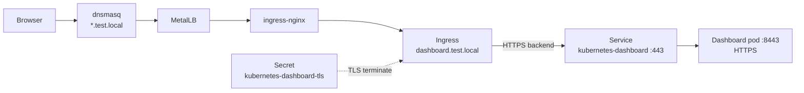

# Setup — Kubernetes Dashboard

Install the Dashboard UI and expose it at `https://dashboard.test.local` (no port-forward).

## Files

| File | Purpose |
|------|---------|
| [`admin-user.yml`](admin-user.yml) | `admin-user` ServiceAccount + `cluster-admin` binding (lab only) |
| [`ingress.yml`](ingress.yml) | Ingress + TLS via `labs-ca-issuer` |

## Architecture



## Prerequisites

- kind cluster (`kind-dev`)
- ingress-nginx + MetalLB + `*.test.local` DNS (same as lab1)
- **cert-manager** + local CA — see [`../README.md`](../README.md) / [`../local-ca.yml`](../local-ca.yml)

```bash
kubectl apply -f https://github.com/cert-manager/cert-manager/releases/download/v1.16.2/cert-manager.yaml
kubectl wait --for=condition=Available deployment --all -n cert-manager --timeout=120s
kubectl apply -f setup/local-ca.yml
```

Trust the labs CA on the host (browser / curl) so `https://dashboard.test.local` has no cert warning — steps in [`../README.md`](../README.md).

## 1) Install Dashboard

```bash
kubectl apply -f https://raw.githubusercontent.com/kubernetes/dashboard/v2.7.0/aio/deploy/recommended.yaml
kubectl -n kubernetes-dashboard wait --for=condition=Available deploy/kubernetes-dashboard --timeout=120s
```

## 2) Admin login account (lab only)

```bash
kubectl apply -f setup/dashboard/admin-user.yml
```

## 3) Ingress

```bash
kubectl apply -f setup/dashboard/ingress.yml
```

Check:

```bash
kubectl get ingress,certificate,secret -n kubernetes-dashboard
kubectl get pods -n kubernetes-dashboard
```

`kubernetes-dashboard-tls` should appear shortly (cert-manager). The Ingress ADDRESS should be the MetalLB IP (e.g. `172.20.255.200`).

## Access

Open:

```
https://dashboard.test.local
```

### Login token

```bash
kubectl -n kubernetes-dashboard create token admin-user
```

On the login page choose **Token**, paste it, and sign in.

Optional — token valid for 24 hours:

```bash
kubectl -n kubernetes-dashboard create token admin-user --duration=24h
```

## Why not port-forward?

Port-forward to the Dashboard often breaks when the browser aborts the TLS handshake to the pod’s self-signed cert (`connection reset by peer`). The Ingress terminates TLS with the labs CA and talks HTTPS to the backend, which is more reliable.

## Cleanup

```bash
kubectl delete -f setup/dashboard/ingress.yml
kubectl delete -f setup/dashboard/admin-user.yml
kubectl delete -f https://raw.githubusercontent.com/kubernetes/dashboard/v2.7.0/aio/deploy/recommended.yaml
```
