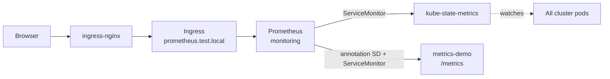

# Setup — Prometheus

Shared Prometheus Operator stack: scrape metrics about **all pods** in the cluster. Used by [lab4](../../lab4/).

## Files

| File | Purpose |
|------|---------|
| [`prometheus.yml`](prometheus.yml) | Prometheus + kube-state-metrics + ServiceMonitors + Ingress + metrics-demo |

## What this creates

| Resource       | Name                 | Notes                                                |
|----------------|----------------------|------------------------------------------------------|
| Namespace      | `monitoring`         | Prometheus + kube-state-metrics                      |
| Prometheus     | `prometheus`         | Scrapes all ServiceMonitors / PodMonitors + annotated pods |
| Service/Ingress| `prometheus`         | UI at `http://prometheus.test.local`                 |
| Deployment     | `kube-state-metrics` | Metrics **about every pod** (`kube_pod_*`)           |
| ServiceMonitor | `kube-state-metrics` | Tells Prometheus to scrape kube-state-metrics        |
| Deployment     | `metrics-demo`       | Tiny app with `/metrics` (annotation scrape demo)    |
| ServiceMonitor | `metrics-demo`       | Scrapes the demo app                                 |

## Architecture



## How Prometheus gets data from all pods

1. **kube-state-metrics** watches the Kubernetes API and exports metrics for every pod (`kube_pod_info`, `kube_pod_status_phase`, `kube_pod_container_status_restarts_total`, …).
2. A **ServiceMonitor** points Prometheus at kube-state-metrics.
3. **Annotation scrape** (extra job in `additional-scrape-configs`): any pod with `prometheus.io/scrape: "true"` is scraped (see `metrics-demo`). Optional annotations: `prometheus.io/port`, `prometheus.io/path`.

## Prerequisites

- kind cluster (`kind-dev`)
- ingress-nginx controller
- MetalLB (LoadBalancer EXTERNAL-IP)
- Wildcard DNS for `*.test.local` (dnsmasq)

Plus the **Prometheus Operator** CRDs + controller (once per cluster):

```bash
kubectl apply --server-side -f \
  https://raw.githubusercontent.com/prometheus-operator/prometheus-operator/v0.78.2/bundle.yaml

kubectl wait --for=condition=Available deployment/prometheus-operator \
  -n default --timeout=120s
```

> The upstream `bundle.yaml` installs the operator into the `default` namespace. That is fine for local labs.

## Apply

From the repo root:

```bash
kubectl apply -f setup/prometheus/prometheus.yml
```

Check status:

```bash
kubectl get prometheus,servicemonitor,podmonitor -A
kubectl get pods -n monitoring
kubectl get pods -l app=metrics-demo
```

Wait until Prometheus is ready:

```bash
kubectl -n monitoring wait --for=condition=Available prometheus/prometheus --timeout=180s
kubectl -n monitoring get pods -l app.kubernetes.io/name=prometheus
```

## Access

```
http://prometheus.test.local
```

### Useful queries (all pods)

In Prometheus → **Graph**:

```promql
# Every pod known to the API
kube_pod_info

# Pod phase (Running / Pending / …)
kube_pod_status_phase

# Restarts per container
kube_pod_container_status_restarts_total

# Demo app custom metric
version
```

### Targets

Open **Status → Targets** and confirm:

- `serviceMonitor/monitoring/kube-state-metrics` — UP
- `serviceMonitor/default/metrics-demo` — UP
- `kubernetes-pods` — UP for `metrics-demo` (annotation scrape)

## Enable scraping on your own pods

Add annotations on the pod template:

```yaml
metadata:
  annotations:
    prometheus.io/scrape: "true"
    prometheus.io/port: "8080"
    prometheus.io/path: "/metrics"
```

The container must serve Prometheus text format on that path/port.

## Cleanup

```bash
kubectl delete -f setup/prometheus/prometheus.yml
```

Optional — remove the Prometheus Operator itself:

```bash
kubectl delete -f \
  https://raw.githubusercontent.com/prometheus-operator/prometheus-operator/v0.78.2/bundle.yaml
```
