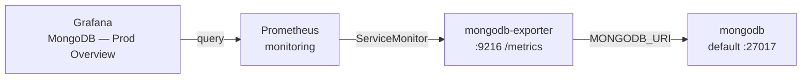

# Setup — MongoDB exporter + Grafana dashboard

Scrapes **MongoDB-specific** metrics (ops, connections, WiredTiger, dbStats, …) into the shared Prometheus / Grafana stack.

Dashboard: [MongoDB — Prod Overview (25227)](https://grafana.com/grafana/dashboards/25227-mongodb-prod-overview/) for [gurjarchetan/mongodb-exporter](https://github.com/gurjarchetan/mongodb-exporter).

## Files

| Path | Purpose |
|------|---------|
| [`mongodb-exporter.yml`](mongodb-exporter.yml) | Secret + Deployment + Service + ServiceMonitor |
| [`dashboards/mongodb-prod-overview.json`](dashboards/mongodb-prod-overview.json) | Grafana board 25227 (datasource → `prometheus`) |

## What this creates

| Resource       | Name               | Notes                                      |
|----------------|--------------------|--------------------------------------------|
| Secret         | `mongodb-exporter` | URI (must match `mongodb-secret` creds)    |
| Deployment     | `mongodb-exporter` | `ghcr.io/gurjarchetan/mongodb-exporter:v1.0.0`, port 9216 |
| Service        | `mongodb-exporter` | ClusterIP `:9216`                          |
| ServiceMonitor | `mongodb-exporter` | Prometheus scrapes `/metrics` every 15s    |

Lives in `default` next to lab MongoDB (`mongodb` Service).

## Architecture



## Prerequisites

- Lab MongoDB applied (`lab2` or `lab4` `main.yml`) — Secret `mongodb-secret`, Service `mongodb`
- Prometheus Operator + [`../prometheus.yml`](../prometheus.yml)
- Grafana ([`../grafana/`](../grafana/))

If you changed MongoDB credentials, edit the `mongodb-uri` key in `mongodb-exporter.yml` to match.

## Apply

From the repo root (after MongoDB + Prometheus + Grafana are up):

```bash
kubectl apply -f setup/prometheus/mongodb/mongodb-exporter.yml

# Include this board with the other Grafana dashboards
kubectl create configmap grafana-dashboards -n monitoring \
  --from-file=setup/prometheus/grafana/dashboards/ \
  --from-file=setup/prometheus/mongodb/dashboards/ \
  --dry-run=client -o yaml | kubectl apply -f -
kubectl -n monitoring rollout restart deployment/grafana
```

Check:

```bash
kubectl get pods,svc,servicemonitor -l app=mongodb-exporter
kubectl wait --for=condition=Available deployment/mongodb-exporter --timeout=120s
```

In Prometheus → **Status → Targets**: `serviceMonitor/default/mongodb-exporter` should be **UP**.

Useful queries:

```promql
mongodb_up
mongodb_connections
rate(mongodb_opcounters_total[1m])
```

## Access

Grafana (`admin` / `admin`):

```
http://grafana.test.local
```

Open **MongoDB — Prod Overview**.

Optional — enable the slow-query profiler row in MongoDB:

```bash
kubectl exec deploy/mongodb -- mongosh -u admin -p changeme --authenticationDatabase admin \
  --eval 'db.adminCommand({ profile: 1, slowms: 0 })'
```

## Cleanup

```bash
kubectl delete -f setup/prometheus/mongodb/mongodb-exporter.yml

# Re-create dashboards ConfigMap without the MongoDB board (or leave it)
kubectl create configmap grafana-dashboards -n monitoring \
  --from-file=setup/prometheus/grafana/dashboards/ \
  --dry-run=client -o yaml | kubectl apply -f -
kubectl -n monitoring rollout restart deployment/grafana
```
